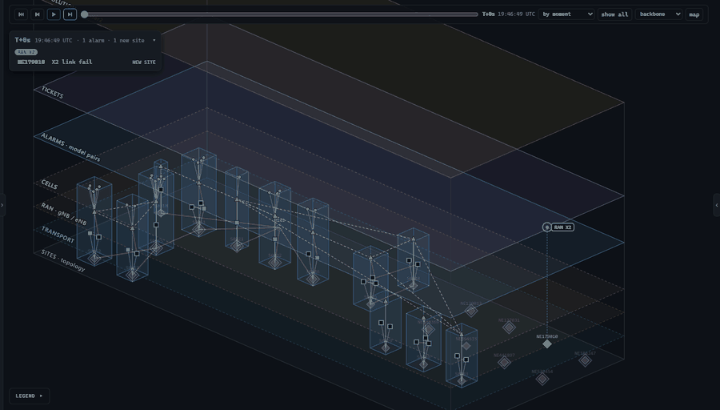
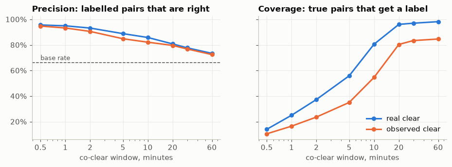
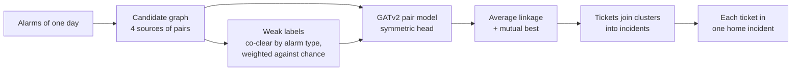
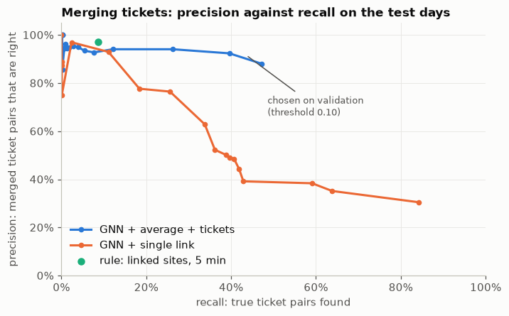
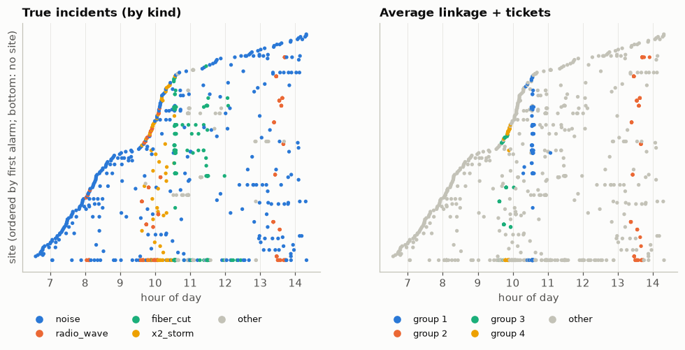
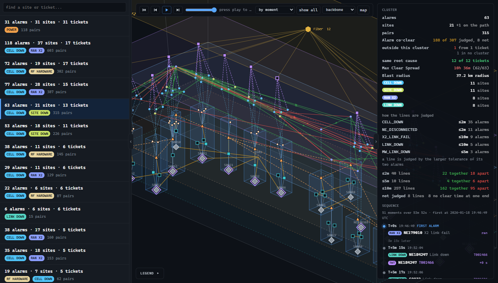

# Alarm → Incident: grouping network alarms with a graph neural network

A single outage in a mobile network fires hundreds of alarms across dozens of sites, and the ticketing system opens a
ticket for each site. Operations staff then chase 40 tickets that are really one problem.

This project groups alarms into **incidents** so that related tickets can be merged. It does so **without any
ground-truth labels**: it learns from weak signals (clear times, tickets, resolution codes), each of which is wrong in
its own way.



*Replay of one incident in the interactive view: alarms arrive in time order over the sites and the devices they are
raised on; tickets and the crews' resolution codes sit on the floors above.* **[Open the live demo](https://autophuwit.github.io/telecom-alarm-grouping-gnn/)**

> The code is a cleaned-up version of a model built on a live operator network. The data in this repository is
> **synthetic**: [`synthetic/generate.py`](synthetic/generate.py) simulates a network and its failure modes, so that
> everything here runs end to end and can be checked against a ground truth.

---

## The problem in one picture

| What happens | What the operator sees |
|---|---|
| A fibre cut behind an aggregation router | 8 sites drop at once: 80+ alarms, 8 tickets |
| A grid outage across a town | sites go down over hours as batteries drain, and crews restore them one by one: hundreds of alarms, dozens of tickets |
| A configuration push | radio links flap across 20 sites, a few minutes apart, often right after a power event in the same area |
| The same board fails again | a fresh ticket hours later; only some are marked as duplicates |

## Why it is hard

There is no incident label. Every candidate stand-in breaks somewhere ([notebook 01](notebooks/01_data_and_labels.ipynb)):

* **Tickets** are one per site, so a multi-site incident becomes many tickets. They also miss alarms that arrive late.
* **Clear times** ("alarms that clear together were caused together") are partly bulk-stamped from the ticket close time,
  and any window trades precision for coverage.
  
* **Resolution codes** written by field crews are noisy, and they describe the fix, not which tickets belong together.
* **Nearly a third of alarms have no site** in the inventory, so a purely topological method cannot place them.

## Approach



| Step | Idea | Code |
|---|---|---|
| Candidate graph | Scoring every alarm pair is out of reach. Candidates come from nearness in time and space, topology links up to 5 hops, the same site within an hour, and the same domain for alarms with no site. Each source catches pairs the others miss. | [`graph.py`](src/aig/graph.py) |
| Weak labels | A pair is positive when the two alarms clear within the tolerance of their alarm types. Tolerances are learned from training tickets only. Each positive is weighted by how much better than chance its kind of pair co-clears (chance is measured on pairs 200+ km apart). | [`labels.py`](src/aig/labels.py) |
| Pair model | Two GATv2 layers pass messages along candidate pairs. A symmetric head scores each pair from both alarm vectors and 19 pair features. The model never sees clear times, tickets or raw coordinates. | [`model.py`](src/aig/model.py) |
| Clustering | Single linkage chains. Average linkage merges two groups only when the **mean** score between them clears the threshold and each is the other's best match. Pairs that were never scored get half the benefit of the doubt. | [`cluster.py`](src/aig/cluster.py) |
| Incidents | Tickets join clusters by the same average, and every ticket ends in exactly one incident. | [`cluster.py`](src/aig/cluster.py) |
| Threshold | Chosen on validation days from **resolution codes only**, as it would be in production. Ground truth is used only to report. | [`run.py`](src/aig/run.py) |

## Results (synthetic data, 4 held-out test days)



| Method | Largest group | ARI | Ticket pairs merged / day | Precision | Recall |
|---|---:|---:|---:|---:|---:|
| Rule: linked sites, within 5 min | 41 | 0.15 | 179 | 97% | 9% |
| GNN + single linkage | 709 | 0.09 | 3,655 | 40% | 67% |
| GNN + average linkage | 80 | 0.44 | 787 | 92% | 38% |
| **GNN + average linkage + tickets** | **84** | **0.49** | **865** | **92%** | **44%** |

*Precision*: of the ticket pairs put in one incident, the share that truly share one. *Recall*: of the ticket pairs that
truly share an incident, the share found. Numbers move by a few points between training runs.

* The simple rule is precise but finds almost nothing. Single linkage finds more but chains background noise into
  groups of hundreds of alarms.
* On the same scores, average linkage keeps precision above 90% while finding **about 5x** the merges of the rule.
* Recall is lowest for slow events: grid outages, where sites go down and come back over hours
  ([notebook 02](notebooks/02_model_and_clustering.ipynb)).



## Interactive view

Numbers convince analysts; operations staff need to **see** an incident. [`aig.view`](src/aig/view.py) renders a day's
incidents into one self-contained HTML page ([`web/template.html`](web/template.html), no build step, no server):

* **3-D floors**, bottom to top: sites and their topology links, the device stack of each site (transport, RAN, cells),
  the alarms with the model's pairs (green: cleared together, red: did not), tickets, and resolution codes.
* **Replay**: start from an empty frame and step through the alarms as they arrived, with a running sequence panel.
* **Cluster panel**: size, how many pairs co-cleared, whether the tickets share a root cause, blast radius, and how
  many of its tickets' alarms ended up outside the incident.
* **Map** of the incident's sites (Leaflet over public tiles).



```bash
python -m aig.view --data data/synthetic --run runs/demo --out docs/index.html
```

## Running live: a refresh every 5 minutes

Batch clustering sees the whole day. An operations map is refreshed every few minutes from the alarms known so far,
and that raises problems batch never meets ([`aig.live`](src/aig/live.py)):

* **Stable IDs.** Each refresh re-clusters from scratch, so a cluster label means nothing from one tick to the next. A
  tracker carries IDs across ticks: an incident keeps its ID while it grows (`202601181946_T002547`: first onset + first
  ticket), the oldest survives a merge and the others point to it, and a split is born with `split_from`.
* **A bounded window.** Each tick re-clusters only the last 3 hours, plus every alarm of an incident still live, so an
  incident is never cut by the window.
* **Freezing.** An incident with no new alarm for 60 minutes is settled and leaves the pool for good.
* **Flicker.** Re-running average linkage as alarms arrive moves borderline alarms back and forth. The map holds a new
  placement back until it has lasted 2 ticks.
* **State** is written to SQLite each tick (incidents, members, events), only what changed.

Replay of one test day (3,019 alarms), compared with the batch clustering of the same day and with the ground truth:

| Setting | Incidents split vs batch | ARI vs batch | Latency p50 / p90 | Ticket-pair precision / recall (truth) |
|---|---:|---:|---:|---:|
| Batch: whole day at once | — | — | — | 98% / 45% |
| Naive: disjoint 30-min blocks | 22% | 0.98 | 13 / 27 min | 98% / 45% |
| 5-min ticks, batch scores | **0.6%** | **1.00** | **2.3 / 7.5 min** | 98% / 45% |
| 5-min ticks, GNN scoring live | 22% | 0.82 | 2.3 / 7.3 min | 97% / 39% |

*Latency: from an incident's second alarm to the first tick it shows on the map.*

* The windowing and the ID tracker cost almost nothing: with the same scores, live matches batch (0.6% of incidents
  split) and an incident appears about 2 minutes after its second alarm.
* The real cost of running live is the **model's view**: the newest alarms are scored before their context has
  arrived. That costs 6 points of recall and more churn (47 flickers a day at hold 2, against 10). Rescoring an
  incident with full context when it settles is the next thing to try.
* A tick takes 0.2 s (p95) including building and scoring the window's graph, far inside a 5-minute budget.

```bash
python -m aig.live --data data/synthetic --run runs/demo --db runs/demo/live.sqlite
```

## Results on production data

<!-- TODO: aggregate figures only, after written approval from the employer (no site names, ticket numbers or raw data). -->
*To be added.*

## What didn't work

Lessons from the production project, kept because they shaped the design:

* **Linking every pair above a threshold.** It chains into giant clusters on any busy day. This is why clustering is
  average linkage.
* **Correlation clustering with weights per kind of pair.** It never beat plain average linkage at the same number of
  merged tickets.
* **Treating unlabelled pairs as weak positives.** It reinforced the chaining it was meant to fix.
* **Coordinates as a feature.** The model memorised which region had the most incidents instead of learning relations.
  Raw coordinates are excluded; only distances between alarms are used.

## Repository layout

```
synthetic/generate.py           network simulator: topology, failures, tickets, ground truth
src/aig/                        the pipeline (data, graph, labels, model, cluster, evaluate, run, view, live)
notebooks/01_data_and_labels    what each weak label gets wrong
notebooks/02_model_and_clustering   candidate graph, pair scores, clustering, error analysis
web/template.html               the interactive view (plain HTML + JS, data injected as JSON)
docs/index.html                 a rendered demo day, served by GitHub Pages
reports/figures/                figures used in this README
```

## Quickstart

```bash
pip install -e .                                  # Python 3.10+, CPU is enough
python synthetic/generate.py --days 14            # writes data/synthetic/
python -m aig.run --data data/synthetic --out runs/demo --train-days 8 --val-days 2   # under a minute on CPU
python -m aig.view --out docs/index.html          # the interactive page for the last test day
```

The notebooks are stored with their outputs. Re-run them in Jupyter, or rebuild them with
`python notebooks/_build_02.py` (the build scripts execute every cell and embed the outputs).

## The synthetic network

The simulator builds regions of sites behind aggregation hubs, with microwave chains and X2 neighbour links, and plays
out seven kinds of incident: site and area power failures, fibre cuts, configuration waves, hardware faults that recur,
neighbour-link storms and background noise. It then records what operations would observe: some equipment missing from
the inventory, tickets that attach only nearby alarms, bulk-stamped clear times and noisy resolution codes. The ground
truth is written separately under `truth/` and is never a model input.

## Limitations

* Synthetic results show how the method behaves, not how it performs in production.
* No pairs across midnight: each day is its own graph.
* Slow incidents (hours between the first and last site) are mostly split.
* Incidents that overlap in time and place are the main source of wrong merges.
